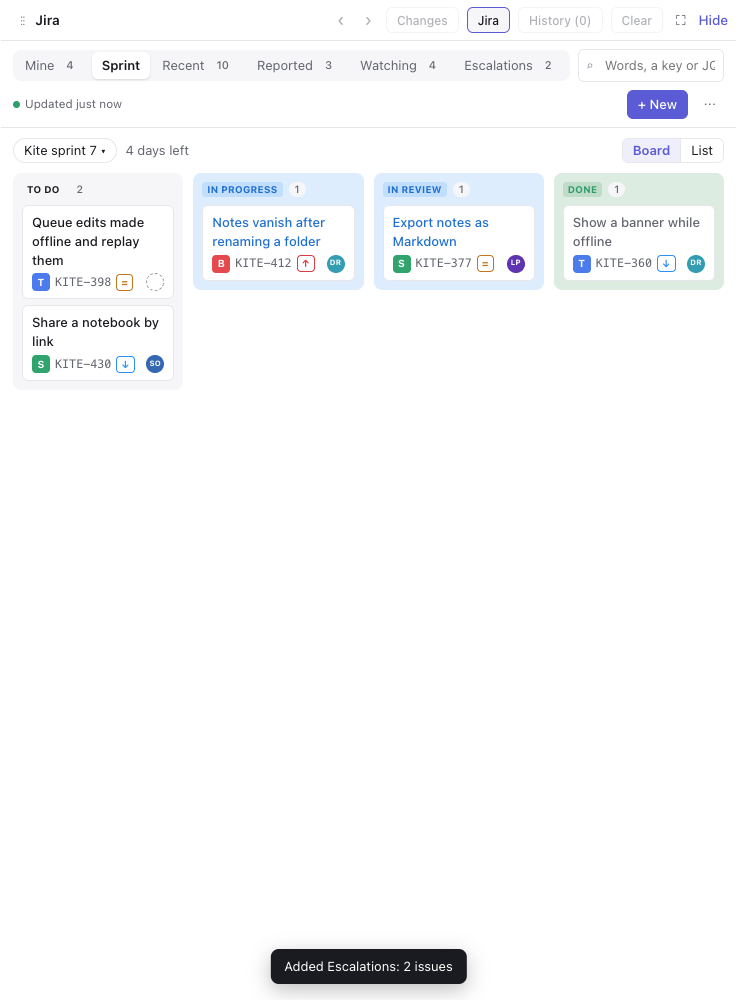
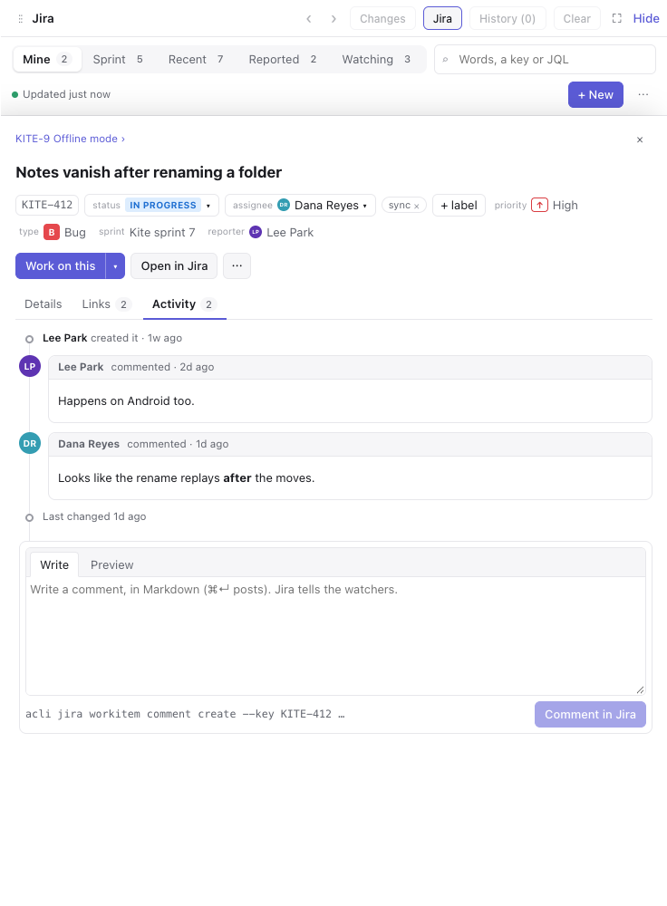
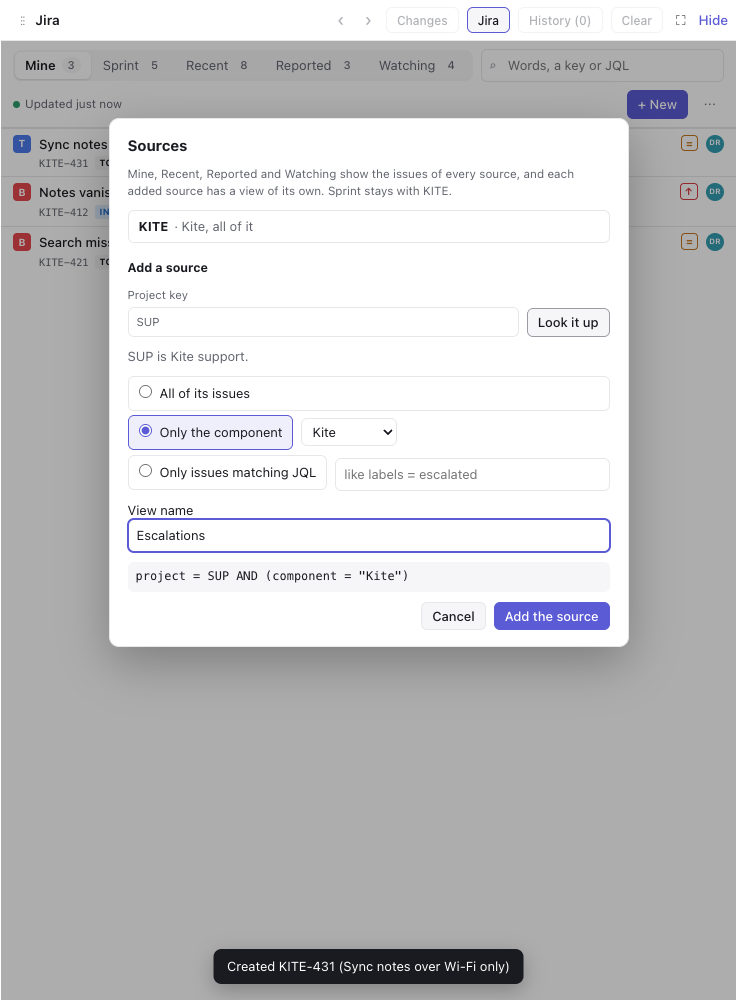
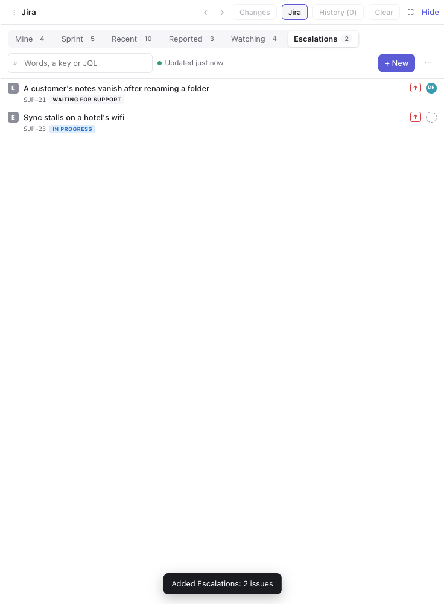

# Jira for Mirador

A [Mirador](https://github.com/sodre90/mirador) plugin: a workspace's Jira project in a tab beside the chat, where you see your issues and the sprint, change them in a click, and hand them to the agent.



- **Connects by itself.** The tab reads the issue keys in the workspace's branches and commits, offers the project they name most, and connects once you confirm.
- **Views.** Mine (my open issues), Sprint, Recent, Reported and Watching, each with its count, and any search saved as a view of your own.
- **More than one project.** Take in another project's issues too, whole or only those of one component or a JQL filter, such as a support project's escalations about your product. Mine, Recent, Reported and Watching span them all, and each added source has a view of its own. Add them in ⋯ → Sources.
- **Search.** Words search the text, a key finds that issue, and JQL goes to Jira as written. Jira's own words show when it can't read the JQL.
- **Sprint board.** The active sprint of your issues, or any open sprint, as columns of its statuses. Drop a card on a column to move it there, or switch to a list.
- **Detail beside the list.** Status, assignee and labels change from their pickers. The description renders Jira's rich text, and edits as Markdown when it can come back unchanged; otherwise it opens in Jira. Links show the parent, sub-tasks, linked issues and an epic's children. Activity shows the comments, and you comment in Markdown.
- **Your own small changes at once, with Undo.** A status, assigning yourself or a label takes effect as you click, with Undo in the toast. Undo won't overwrite a change someone made since.
- **Asks first when others would be told.** Comments, a new summary or description, assigning someone else, and new issues show the `acli` command they run and wait for you.
- **Work on this.** Start a conversation on an issue, or plan an epic with the agent, send it to the current conversation, or mention it in the composer. The agent is told to ask before it changes anything in Jira.
- **Easy on Jira.** It reads the list when it shows, then every two minutes while you look, at most one read of each list per few seconds and three `acli` calls at once.
- **Keys.** `1`–`9` switch views, `j` `k` move, `/` searches, `n` makes a new issue, `w` works on it, `c` comments, `o` opens it in Jira, `r` reads again, `Esc` closes it.








Everything goes through the [Atlassian CLI](https://developer.atlassian.com/cloud/acli/) (`acli`) signed in on your computer: `acli jira auth login --web`. The plugin keeps no copy of your issues beyond what the tab shows. It needs Mirador with plugin API 7, and is tested with acli 1.3.

To install it, add `https://github.com/sodre90/mirador-jira.git` in Settings → Plugins.

## Developing

```bash
bun install
bun run build       # the view, into dist/view.js
bun run typecheck
bun run test        # unit tests, against a fake Jira
scripts/e2e.sh      # e2e in a Mirador test host from MIRADOR_DIR, with a fake acli on its PATH
```

`MIRADOR_DIR` is Mirador's checkout, by default `../visualized-claude-sessions`. `mirador/api.ts` is a copy of the plugin API types Mirador doesn't publish yet. `JIRA_SCREENSHOTS=<folder> scripts/e2e.sh` also saves a screenshot of each view, as in `docs/`.

Releases: bump `version` in `plugin.json`, commit, and tag the commit `v<version>`. Mirador installs the newest release and offers newer ones as updates.
